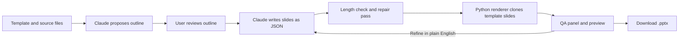

# Deck Copilot

Deck Copilot is an AI deck builder that turns raw notes, documents, spreadsheets and images into a finished PowerPoint file on a branded template. Before rendering, it shows the user every change the AI made to their content, so nothing changes without them seeing it.

## Status

Built and tested. Not publicly released. The source code is private. This repo is only a summary.

## My role

I built it solo. I came up with the product, designed the workflow and the architecture, made the scope calls, and ran every test round myself.

I used Claude Code as my pair programmer for the implementation. I worked in short build rounds: I scoped each round, Claude Code wrote the code with me, and I reviewed and tested the result. I used ChatGPT as an outside reviewer that graded each round. Before the final hardening pass I had the whole codebase independently audited, then worked through the findings.

## Stack

Next.js 15, React 19, TypeScript, Tailwind, Claude API (Sonnet 5 with tool use), Python with python-pptx, LibreOffice for previews, vitest, GitHub Actions.

## How it works

1. The user picks a template and adds source material: pasted notes, Word files, spreadsheets, PDFs or images.
2. Claude proposes an outline. Each slide gets a slide type from that template's library, and Claude lists any open questions about the content. The user can edit, reorder or swap slide types.
3. Claude writes each slide as structured JSON that matches the schema for its slide type.
4. A repair pass checks every field against shared length limits. Anything too long goes back to Claude in one batch to be rewritten shorter, keeping numbers, names and dates intact.
5. A Python renderer clones the template's real slides, fills them in, and adds native charts, icons and speaker notes. A final guardrail trims at sentence boundaries if anything still doesn't fit.
6. A QA panel lists every rewrite, every trim and any claim worth fact-checking. The user refines slides in plain English or edits text directly, then downloads the .pptx.

It works with any organization's PowerPoint template. Each one is set up once by mapping its slides to slide types, and swapping in another brand's template is quick. The largest template has 23 slide types, including timelines, KPI dashboards, risk matrices, decision slides and native charts.

## Decisions

- **One set of length limits for both languages.** The TypeScript app and the Python renderer read the same limits file, and a test fails if they drift apart. That way the editor never warns about one limit while the renderer cuts at another.
- **Rewrite first, cut last.** Text that's too long gets rewritten shorter by the AI, and hard trimming is the last resort. Every change shows up in the QA panel, because a silently chopped number in an exec deck is the worst possible failure.
- **Clone real template slides.** The renderer copies actual slides from the template instead of drawing lookalike layouts, so fonts, colors and brand elements come through as designed.
- **Hold the model with the schema, not just the prompt.** When a user refines a slide, the tool schema only allows that slide's current type unless they ask for a new layout.
- **Cut a feature that worked.** I built a round trip that let users edit a downloaded deck in PowerPoint and upload it to keep going. It worked, but it added a second editing model and a lot of ways to fail, for a job the in-app editor already did. I removed it.

## Quality

Test run on October 19, 2026, in a fresh Linux environment:

- 51 Python checks pass. They cover render integrity, exact icon placement, trimming quality, limit drift between the two languages, chart and copy consistency, and layout geometry.
- 37 TypeScript unit tests pass (vitest), and the TypeScript build is clean.
- A stress test renders all 23 slide types at maximum length with 441 tracking tokens. It fails if any token disappears without a visible "+N more" marker, or if any shape lands off the slide.
- GitHub Actions runs the full suite on every push.

The automated tests don't call the AI model. AI output was checked through a 13-section manual test script and live runs.

## Timeline

- First commit: June 9, 2026
- Last commit: July 12, 2026

## What I'd do next

- Self-serve templates: upload any .pptx and have the app map its layouts to slide types, instead of setting each one up in code.
- Finish the spreadsheet-to-chart feature. The engine is built and tested but not yet in the UI.
- Add prompt caching to cut cost and wait time on repeat calls.

[kylegtobin.com](https://kylegtobin.com) · [LinkedIn](https://www.linkedin.com/in/kylegtobin/)
